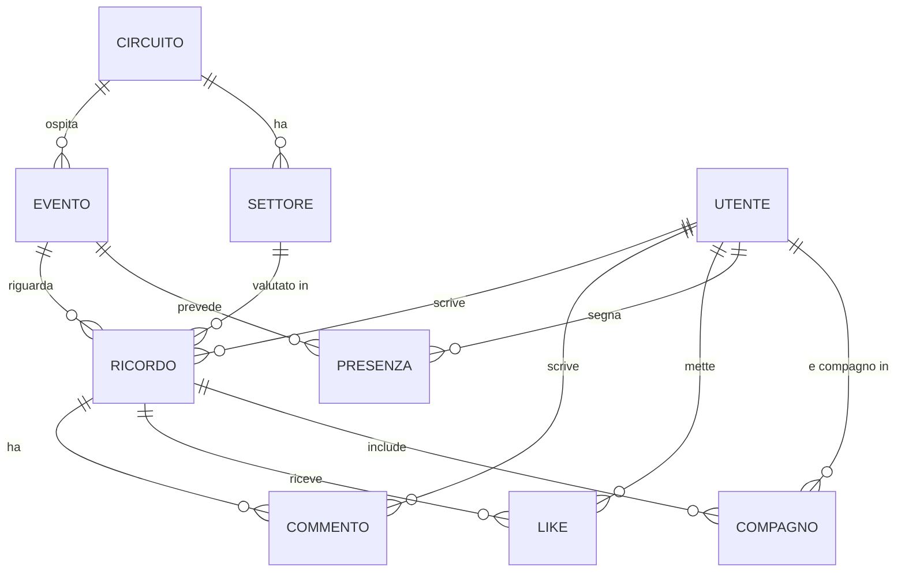

# F1 Diary

Applicazione web in React per chi segue la Formula 1 dal vivo. Si registrano nel diario i Gran Premi a cui si è assistito, si valuta il circuito **per settore** (tribuna, curva, prato) e si condivide l'esperienza con una community che può mettere like e commentare. Chi deve scegliere il prossimo GP trova il calendario, la classifica dei circuiti e può segnare la propria presenza futura.

Progetto per il corso di **Front-end Engineering** (a.a. 2026/27).

**Autori:** Francesco Di Giacomo · Simone Brandolini · Stefano Giuliani

**App online:** <URL-del-deploy-su-Vercel>

## Funzionalità

### Nucleo

- **Catalogo** di Gran Premi e circuiti, filtrabile (stagione, paese, fascia di voto) e ordinabile (data, voto).
- **Ricordi:** si creano, modificano ed eliminano con form controllati. Ogni ricordo valuta un settore del circuito su quattro criteri (visuale, atmosfera, servizi, trasporti), contiene un racconto e può indicare gli altri utenti che erano presenti.
- **Community:** lettura dei ricordi altrui, commenti e like.
- **Presenze future:** si segna che si andrà a un Gran Premio.
- **Profilo** con statistiche: Gran Premi visti, circuiti e paesi diversi, voto medio assegnato, settore valutato meglio.
- **Classifica dei circuiti** e miglior settore, calcolati a runtime dai voti dei ricordi (nessun valore derivato viene salvato).
- **Scelta del profilo** da un elenco, senza password (vedi [Identità degli utenti](#identità-degli-utenti)).

### Estensioni (non garantite)

Foto e video dell'evento, MVP del GP, «spettatore migliore» con percentuale di vittorie, lista dei desideri.

## Tecnologie e architettura

- **Front end:** React 19 su Vite
- **Stile:** Tailwind CSS
- **Navigazione:** React Router
- **Database:** Supabase
- **Server in sviluppo:** json-server
- **Deploy:** front end su Vercel, dati su Supabase

L'architettura è *serverless* di tipo Backend as a Service. Il browser parla direttamente con il database tramite l'API di Supabase e le regole di accesso stanno nel database, come policy di Row Level Security. Non ci sono funzioni lato server: l'API esterna (Jolpica) si chiama dal browser.

Tutte le chiamate ai dati sono in un solo modulo, `src/api.js`: i componenti usano le sue funzioni e non chiamano mai `fetch` direttamente. Così json-server in sviluppo e Supabase in produzione differiscono per un solo file.

## Dati

### Fonte esterna: Jolpica F1

I circuiti e i calendari delle stagioni vengono dall'API pubblica [Jolpica F1](https://github.com/jolpica/jolpica-f1), senza chiave:

### Copia, non riferimento

Circuiti ed eventi vengono **copiati nel nostro database** la prima volta che servono. Un evento è identificato da stagione + round. Motivi:

- filtri, classifiche e statistiche uniscono i voti degli utenti ai dati dell'evento direttamente nel database;
- ricordi, commenti, like e presenze hanno chiavi esterne stabili;
- l'app funziona anche se l'API è temporaneamente irraggiungibile.

I dati secondari (risultati, classifiche, giri) non si copiano: si leggono dall'API quando l'utente apre la pagina del Gran Premio.

### Modello dei dati



| Entità | Descrizione |
| --- | --- |
| Utente | chi usa l'app |
| Circuito | un impianto (id, nome, città, paese) |
| Evento | un Gran Premio (stagione, round, nome, data), appartiene a un circuito |
| Settore | una zona del circuito (es. Tribuna principale, Curva, Prato), appartiene a un circuito |
| Ricordo | esperienza di un utente a un evento, in un settore (quattro voti, racconto) |
| Commento | testo di un utente su un ricordo |
| Like | un utente mette like a un ricordo |
| Presenza | un utente segna che andrà a un Gran Premio futuro |
| Compagno | un utente che ha assistito all'evento con l'autore del ricordo |

Like, presenze e compagni sono relazioni molti-a-molti.

## Identità degli utenti

Si usa il livello «chi sono io»: l'utente sceglie un profilo da un elenco predefinito, senza password, e può cambiarlo in qualunque momento dalla barra di navigazione. L'app presume che la scelta sia sincera, quindi le regole del database non possono impedire di modificare i ricordi altrui.

## Avvio in locale

Requisiti: Node.js e npm. Il progetto parte da un clone pulito:

```bash
git clone <URL-del-repository>
cd <cartella-del-progetto>
npm install
```

In sviluppo i dati stanno su json-server. Avvialo in un terminale con il file `db.json` del progetto (di solito `npx json-server db.json) e in un secondo terminale lancia:

```bash
npm run dev
```

Apri poi l'indirizzo mostrato da Vite.

### Usare Supabase

Crea nella radice del progetto un file `.env.local` con l'indirizzo e la chiave pubblica del tuo progetto Supabase:

```
VITE_SUPABASE_URL=<URL-del-progetto>
VITE_SUPABASE_ANON_KEY=<chiave-pubblica>
```

I nomi delle variabili sono indicativi: usa quelli letti da `src/api.js`. 

## Deploy

Il front end è pubblicato su Vercel, che genera un nuovo deploy a ogni push, mentre i dati stanno su Supabase. Le due parti si collegano con le stesse variabili d'ambiente, da impostare nelle impostazioni del progetto su Vercel perché `.env.local` non viaggia con il repository.

## Crediti

- Dati dei circuiti e dei calendari: [Jolpica F1](https://github.com/jolpica/jolpica-f1).
- Progetto didattico, non affiliato né approvato da Formula 1 o dalla FIA.
